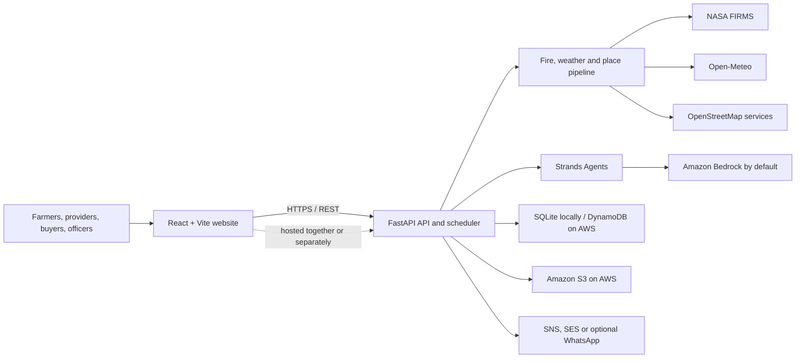

# NabhoNetra

NabhoNetra helps communities respond to crop-residue fires. It combines satellite fire detections with wind forecasts to estimate smoke risk, alerts affected people, and coordinates requests for machinery or biomass collection. Field officers review evidence before an outcome is counted as verified.

## Architecture

The project is a React single-page app, a FastAPI service, and a data pipeline. The service refreshes fire and weather data in the background, builds alerts, serves the API and (when built) the website, and coordinates user requests.



The pipeline reads fire detections from NASA FIRMS, gets wind and air-quality data from Open-Meteo, and uses OpenStreetMap's Overpass and Nominatim services for nearby listings and place names. The frontend uses Leaflet with Esri and CARTO map tiles. The AI alert writer uses **Strands Agents** with **Amazon Bedrock** by default; OpenAI-compatible APIs and Ollama are alternative model providers. Alerts are checked against cluster facts and fall back to templates if model output is unavailable or fails validation.

Locally, the application stores data in SQLite. The AWS deployment uses DynamoDB for application records and S3 for snapshots, cached listings, and evidence. A background refresh scheduler runs inside the API service; the included App Runner template intentionally limits the service to one instance to avoid duplicate schedulers.

## AWS services and technology

| Service or technology | How this repository uses it |
|---|---|
| **AWS App Runner** | Runs the containerized FastAPI API, refresh scheduler, and optionally the built website. |
| **Amazon ECR** | Stores the container image built by `deploy/deploy.sh` or `deploy/deploy.ps1`. |
| **Amazon DynamoDB** | Five tables for subscribers, alerts, interventions, one-time codes, and the audit trail. |
| **Amazon S3** | Stores data snapshots, cached place/resource listings, and intervention evidence. |
| **AWS Secrets Manager** | Supplies `FIRMS_KEY` and `ADMIN_TOKEN` to the App Runner service. |
| **Amazon Bedrock + Strands Agents** | Generates checked alert text by default (Llama 3.3 70B in the template); templates are the fallback. Enable model access in the selected region. |
| **Amazon SNS** | Sends SMS in live mode and provides the optional CloudWatch alarm notification topic. |
| **Amazon SES** | Optional email delivery; configure a verified sender (`SES_FROM`). Local email can instead use SMTP. |
| **AWS End User Messaging Social** | Optional WhatsApp delivery; requires an approved WhatsApp Business setup and is not verified by this project. |
| **AWS Amplify Hosting** | Optional hosting for the static frontend, with security headers. The default deployment can serve it from App Runner instead. |
| **AWS CloudFormation and IAM** | `deploy/apprunner.yaml` defines the service, storage, secrets, roles, and alarm as a stack. |
| **Amazon CloudWatch** | Collects App Runner logs and receives the configured 5xx alarm. |
| **React, Vite, Leaflet, FastAPI, Python** | Frontend, map, API and pipeline implementation. The Dockerfile builds the website and packages it with the Python service. |

## Build and run locally

**Requirements:** Python 3.12, Node.js 20, and npm. Docker is only needed for the container option below.

From the repository root:

```bash
# Backend
cd backend
python -m venv .venv
source .venv/bin/activate             # Windows PowerShell: .\.venv\Scripts\Activate.ps1
python -m pip install -r requirements.txt
cp .env.example .env                  # Windows PowerShell: Copy-Item .env.example .env
```

For live fire data, set `FIRMS_KEY` in `backend/.env`. Set a long random `ADMIN_TOKEN` as well if you will use administrative actions. Keep the file private; it is ignored by Git. For an offline sample run, use the mock settings below instead.

```bash
# Build the website; the API serves frontend/dist when it exists
cd ../frontend
npm ci
npm run build

# Start the API and website
cd ../backend
python server.py
```

Open <http://127.0.0.1:8000>. The first live refresh may take a few minutes while the pipeline retrieves external data.

To use sample fire data without external data or message delivery, set these variables before starting the server:

```bash
export PIPELINE_MOCK=1 USE_AGENT=0 DELIVERY=log AUTO_ALERT=0
python server.py
```

In PowerShell, set each with `$env:PIPELINE_MOCK="1"` (and likewise for the other variables). For frontend hot reload, leave the API running, then in another terminal run `cd frontend; npm run dev` and open <http://localhost:5173>; Vite proxies `/api` requests to port 8000.

## Deploy locally with Docker

Build and run the combined API and website container from the repository root:

```bash
docker build -t nabhonetra:local .
docker run --rm -p 8000:8000 \
  --env-file backend/.env \
  -v nabhonetra-data:/data \
  nabhonetra:local
```

Then open <http://127.0.0.1:8000>. The named volume preserves the SQLite database at `/data/nabhonetra.db`. For a sample run, pass the mock settings with `-e`, or put them in the environment file. The image uses Python 3.12, builds the frontend with Node 20, and runs as a non-root user.

## Shipping and deployment options

| Option | Use it when | How it works |
|---|---|---|
| **Docker locally or on your own host** | You want to run the complete app outside AWS. | Build with the root `Dockerfile`; persist `/data` and provide backend settings. |
| **App Runner serves both API and website** | You want the simplest AWS deployment and one URL. | Default for `deploy/deploy.sh`; the App Runner service serves the built static website and API from the same origin. `deploy/deploy.ps1` supports this option from PowerShell. |
| **Amplify frontend + App Runner API** | You want a separately hosted frontend with Amplify's CDN and security headers. | Set `FRONTEND=amplify` for `deploy/deploy.sh`; the script publishes the built frontend to Amplify and configures the API's CORS origin. |
| **Amplify Git-based builds** | You want Amplify to rebuild the frontend on pushes. | Connect the repository in Amplify, set the app root to `frontend`, and set `VITE_API_URL` to the App Runner URL. Configure the API with the deployed site's `CORS_ORIGINS` and `PUBLIC_URL`. `amplify.yml` contains the build settings. |

## Deploy to AWS

The included deployment scripts create or update a CloudFormation stack named `nabhonetra` by default. The template is marked **untested in an AWS account**; review it and deploy to a test account before relying on it in production.

### Prerequisites

- An AWS account, AWS CLI credentials, Docker, and permission to use App Runner, ECR, CloudFormation, IAM, DynamoDB, S3, Secrets Manager, SNS, and CloudWatch. Amplify is also needed for the split frontend option. AWS CloudShell includes the CLI and Docker.
- A NASA FIRMS map key and a strong `ADMIN_TOKEN` (at least 16 letters, digits, hyphens, or underscores).
- `us-west-2` is the script's default region and the template's default Bedrock region. Enable access to the configured Bedrock model in that region if you want AI-generated alerts; otherwise alert templates are used.
- For live email, verify an SES sender and provide `SES_FROM`. AWS account SMS limits or regional requirements may apply to SNS. Start in log delivery mode to avoid sending real messages.

### Deploy from CloudShell (Linux/macOS shell)

Upload or otherwise make the repository available in CloudShell, then run from its root:

```bash
read -rsp "NASA FIRMS key: " FIRMS_KEY; echo
export FIRMS_KEY
export ADMIN_TOKEN="$(openssl rand -hex 24)"
echo "Store this admin token securely: $ADMIN_TOKEN"

# One URL: App Runner serves the API and website
DELIVERY_MODE=log bash deploy/deploy.sh

# Or split frontend and API across Amplify and App Runner
# FRONTEND=amplify DELIVERY_MODE=log bash deploy/deploy.sh
```

The script builds the container, pushes it to ECR, deploys the CloudFormation stack, and prints the site and API URLs. It defaults to `FRONTEND=apprunner`; use `FRONTEND=amplify` for the split option. Do not publish or commit the generated admin token. Optional deployment settings include `REGION`, `STACK`, `OPS_EMAIL`, `SES_FROM`, and `PUBLIC_URL`.

### Deploy from Windows PowerShell

With Docker Desktop and the AWS CLI installed and configured, run from the `deploy` directory:

```powershell
cd deploy
.\deploy.ps1 -FirmsKey "YOUR_FIRMS_KEY" `
  -AdminToken "YOUR_LONG_RANDOM_TOKEN" -DeliveryMode log
```

This script deploys the App Runner-hosted website and API. The PowerShell script does not deploy the frontend separately to Amplify.

### After deployment

Create the first administrator using credentials for the deployed DynamoDB tables. For the default stack and region, run from `backend`:

```bash
STORE=dynamodb DDB_PREFIX=nabhonetra STORE_REGION=us-west-2 \
  python3 make_admin.py --name "Your name" --channel email --contact you@example.com
```

Check `https://<your-app-runner-host>/api/health`, then sign in through the website. To send real notifications, redeploy with `DELIVERY_MODE=live` and configure delivery providers first. App Runner continues to incur charges while running; check current AWS pricing for all enabled services.

## Tests

Backend commands run from `backend/` after installing `requirements.txt`; install `requirements-dev.txt` for tests that use the development dependencies:

```bash
python smoke_test.py
python eval_agent.py
python scope_test.py
python env_test.py
python dynamo_test.py
```

The DynamoDB/S3 test uses Moto rather than a live AWS account. Frontend tests run from `frontend/`:

```bash
npm ci
npm test
```

## Repository layout

```text
backend/    FastAPI server, fire pipeline, Strands agent, storage, and tests
frontend/   React/Vite website and frontend tests
deploy/     App Runner CloudFormation template and deployment scripts
Dockerfile  Multi-stage frontend build and Python runtime image
amplify.yml Optional Amplify Git build configuration
```
