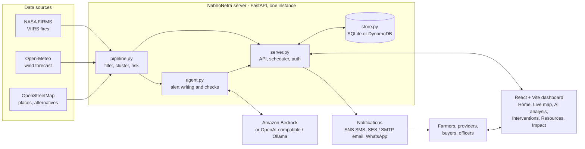

# NabhoNetra: crop-fire intelligence

Detects crop-residue fires from NASA FIRMS, groups them into clusters, ranks them by wind and distance to a target city, names the place and
detection time, has an AI agent write an alert, and sends it to verified subscribers (farmers, machine providers, biomass buyers, officers).

**Contents:** [Problem](#the-problem) · [How it works](#how-it-works-end-to-end) · [Architecture](#architecture) · [AWS services](#aws-services-used-and-why) · [Setup](#installation-and-setup) · [Local vs AWS](#local-development-vs-aws-deployment) · [Roadmap](#future-improvements-roadmap)

## The problem
Every autumn, burning of paddy residue (stubble) across north-west India sends smoke over cities such as Delhi. Farmers often burn because they see no affordable alternative in time, and the people who could help (machine providers, biomass buyers, local officers) rarely know where fires are starting or who needs them. Satellite data exists, but it is raw heat anomalies, not a decision.

NabhoNetra turns those detections into something people can act on: *which* fire clusters matter most for a city, *who* nearby can offer an alternative to burning, and *whether* the help actually happened. It is an early-warning and coordination aid. Its risk index is an estimate from wind, distance and fire count, not a measured share of city air quality, and the Impact page shows an association, not proof of cause.

## How it works end to end
1. **Detect.** `backend/pipeline.py` fetches VIIRS fire detections from NASA FIRMS (a bounding box in city scope, or all of India with `SCOPE=india`).
2. **Filter.** Low-confidence detections and repeating (likely industrial) heat sources are dropped.
3. **Cluster.** Nearby detections are grouped; place names (OpenStreetMap/Nominatim) and detection times are attached.
4. **Score risk.** Each cluster's smoke is moved along the 24-hour Open-Meteo wind forecast to see whether and when it reaches the target city. Clusters get a priority (high / medium / low) from wind, distance and fire count.
5. **Generate alerts.** `backend/agent.py` asks the AI model (Bedrock by default) for a short alert; the text is checked for fire count, place and nearest alternative, retried once, then replaced by a template if it still fails. Low-priority clusters use templates.
6. **Register.** People join as farmer, machine provider, biomass buyer or officer, confirm their contact with a one-time code, and consent is recorded. Administrators are created only on the server (`make_admin.py`).
7. **Intervene.** For each high or medium cluster an intervention is opened; matched providers and buyers get requests, farmers and officers get notices (SMS via SNS, email via SES/SMTP, optional WhatsApp), only if they consented.
8. **Verify impact.** Providers accept and report completion (note, optional photo); an officer verifies or rejects each claim and a satellite re-check is attached. Only officer-verified outcomes count on the Impact page.

Details of each stage are in [How the agent works](#how-the-agent-works) and [Registry and interventions](#registry-and-interventions).

## Architecture

The React build is served by the same Python server, so one container runs everything. A scheduler inside the server refreshes data every `REFRESH_HOURS` (default 3).

## AWS services used and why
All AWS use is optional for local runs; the template is `deploy/apprunner.yaml`.

| Service | Used for | Why |
|---|---|---|
| App Runner | Runs the Docker image (one instance) | Managed HTTPS hosting without servers. One instance only, because the scheduler runs inside the app |
| ECR | Stores the Docker image | App Runner pulls from it |
| DynamoDB | Subscribers, alerts, one-time codes (TTL), interventions, audit trail | Durable data that survives redeploys; the audit table is append-only for the app |
| S3 | Latest data snapshot and evidence photos | Cheap object storage; restarts do not lose the last result |
| Bedrock | Writes alert text (default model `us.meta.llama3-3-70b-instruct-v1:0`) | Managed model access with the instance IAM role, no API key. Model access must be enabled in the console |
| SNS | SMS alerts and verification codes | Direct SMS publish. Sandbox and India DLT rules apply |
| SES | Email alerts and verification codes | Managed email (`EMAIL_PROVIDER=ses`); sandbox needs verified addresses |
| AWS End User Messaging Social | Optional WhatsApp messages | Needs an approved WhatsApp Business account (untested here) |
| Secrets Manager | `ADMIN_TOKEN` and `FIRMS_KEY` | Keeps secrets out of the image and plain settings |
| IAM | Instance role with least-needed permissions for the services above | App Runner access role for ECR |
| CloudWatch | Logs and an alarm on server errors (notified by an SNS topic to `OpsEmail`) | Basic operations visibility; in `log` mode sign-in codes for staff appear in the logs |
| CloudFormation | Creates all of the above from `deploy/apprunner.yaml` | One repeatable deploy |

## Installation and setup

### Prerequisites
- Python 3.12 and Node.js 20 (these match the Dockerfile)
- A free NASA FIRMS map key (`FIRMS_KEY`)
- One AI model option: AWS Bedrock access, a Gemini/OpenAI-compatible key, or local Ollama. Without a working model, alerts fall back to templates
- For deployment only: an AWS account, AWS CLI v2 signed in, and Docker

### Key environment variables (`backend/.env`, copy from `.env.example`)
| Variable | Meaning |
|---|---|
| `FIRMS_KEY` | NASA FIRMS key (required for real data) |
| `ADMIN_TOKEN` | Long random secret (16+ characters) for operator API calls; also the default signing secret |
| `SCOPE` | `city` (default, uses `BBOX`, `CITY_LAT`, `CITY_LON`) or `india` |
| `DELIVERY` | `log` (test mode, nothing sent) or `live` |
| `MODEL_PROVIDER`, `MODEL_ID`, `MODEL_API_KEY`, `MODEL_BASE_URL` | AI model: `bedrock` (default), `openai` or `ollama` |
| `STORE` | `sqlite` (default) or `dynamodb` (with `DDB_PREFIX`, `STORE_REGION`, `SNAPSHOT_BUCKET`) |
| `EMAIL_PROVIDER`, `SES_FROM`, `SMTP_*` | Email delivery |
| `PUBLIC_URL` | Public site address, used in provider response links |

Frontend: `frontend/.env.example` only has the optional `VITE_DATA_URL`; anything starting with `VITE_` is public.

### Local development
Backend (PowerShell shown; on macOS/Linux use `python3 -m venv .venv && source .venv/bin/activate` and `cp`):

    cd backend
    python -m venv .venv; .\.venv\Scripts\Activate.ps1
    pip install -r requirements.txt
    copy .env.example .env      # then edit: FIRMS_KEY, ADMIN_TOKEN, model settings
    python server.py            # API on http://127.0.0.1:8000

Frontend, either as a production build served by the backend (build it, then restart the server):

    cd frontend; npm install; npm run build

or with hot reload (the dev server proxies `/api` to port 8000):

    cd frontend; npm install; npm run dev     # http://localhost:5173

For a quick look with sample data and no network: `$env:PIPELINE_MOCK="1"; python server.py` (bash: `PIPELINE_MOCK=1 python server.py`).
Tests: `cd frontend; npm test`, and the backend checks in [Check it works](#check-it-works).

### Build and ship
Docker (local or any container host):

    docker build -t nabhonetra .
    docker run -p 8000:8000 --env-file backend/.env -v nabhonetra-data:/data nabhonetra

The image builds the frontend, bundles it with the backend and stores SQLite in `/data`. To ship to AWS, follow [Deploy on AWS (App Runner)](#deploy-on-aws-app-runner) below, then create the first administrator.

## Local development vs AWS deployment
| | Local | AWS (App Runner) |
|---|---|---|
| Storage | SQLite file (`STORE=sqlite`) | DynamoDB + S3 (`STORE=dynamodb`) |
| AI model | Bedrock, Gemini/OpenAI-compatible or Ollama | Bedrock through the instance IAM role |
| Secrets | `backend/.env` | Secrets Manager |
| Messages | `DELIVERY=log` by default | `DeliveryMode` parameter (`live` is the template default; use `log` for a first try) |
| Admin creation | `python make_admin.py` | Run `make_admin.py` from your computer against the tables |
| Frontend | Vite dev server or `dist/` | `dist/` baked into the image |

## All-India mode
Set `SCOPE=india` in `backend/.env` (restart the server). The app then asks NASA FIRMS for every VIIRS detection in India (country query `IND`; if that fails it falls back to an India bounding box, which also includes slivers of neighbouring countries), keeps the `MAX_CLUSTERS` biggest clusters nationwide (default 25), and pairs each with its nearest major city from `backend/cities.py` for the wind and smoke forecast. Alerts name that city. The home page shows the scope instead of one target city, and the map has no single "target" marker. `BBOX`, `CITY_*` are ignored. Check with `python scope_test.py`.
Caveats: FIRMS reports all thermal anomalies, so outside the October to November paddy season many detections are forest or industrial fires, not crop burning. First refresh is slower (place names and OpenStreetMap listings are looked up for more areas; both are cached).

## Before real users
- `DELIVERY=log` records alerts and shows verification codes on screen (test mode). Set `DELIVERY=live` to really send.
- SMS (Amazon SNS): new accounts are in the SMS sandbox (verified numbers only). India also needs sender ID and DLT registration.
- Email: Amazon SES (`EMAIL_PROVIDER=ses`) or SMTP. SES starts in a sandbox: verify the sender and each recipient until production access is granted.
- Subscribers confirm their contact with a one-time code, can delete their data from the Join form, and registration is rate-limited per IP.
- Officers are registered by an administrator who is signed in. Administrators are created only on the server with `python make_admin.py` (no web page or API route creates one). Keep `ADMIN_TOKEN` long and secret: it is for scripts and operators calling the API, and the website never asks for it or stores it.
- Alternatives (machine shops, biomass plants) come from OpenStreetMap and are not verified. Nothing is shown if none are found.

## Deploy on AWS (App Runner)
`deploy/deploy.ps1` builds the Docker image, pushes it to ECR and deploys `deploy/apprunner.yaml`: App Runner (one instance, because the scheduler runs inside the app), DynamoDB tables for subscribers, alerts, verification codes, interventions and the audit trail (kept if the stack is deleted), an S3 bucket for the latest data snapshot and evidence photos, Secrets Manager for the admin token and FIRMS key, an IAM role for Bedrock, SNS, SES and S3, and a CloudWatch alarm on server errors. The template passes `cfn-lint`, but review it and run it in a test account first.

Needs: an AWS account, AWS CLI v2 signed in (`aws configure`), Docker Desktop running, and Bedrock model access enabled for the model in `ModelId` (Bedrock console, Model access) in the same region.

    cd deploy
    .\deploy.ps1 -FirmsKey KEY -AdminToken LONG_TOKEN -OpsEmail you@example.com -SesFrom verified@example.com -DeliveryMode log
The last line printed is the live address (`https://....awsapprunner.com`). `-DeliveryMode log` is a safe first try: nothing is sent, and farmer and provider codes show on screen. Re-run without it, once SES and SNS are ready, to go fully live.

### No Docker on your PC? Use AWS CloudShell
CloudShell (the `>_` icon in the AWS console top bar, region US West (Oregon)) already has Docker and the AWS CLI. Upload the project zip (Actions, Upload file), then:

    unzip -q cropfire-agent-updated.zip; cd cropfire-agent/deploy
    read -rsp "FIRMS key: " FIRMS_KEY; echo; export FIRMS_KEY
    export ADMIN_TOKEN=$(openssl rand -hex 24); echo "SAVE THIS ADMIN TOKEN: $ADMIN_TOKEN"
    DELIVERY_MODE=log bash deploy.sh
If the build stops with "no space left on device", run `docker system prune -af` and start again. Create the first administrator in the same window:

    cd ../backend
    STORE=dynamodb DDB_PREFIX=nabhonetra STORE_REGION=us-west-2 python3 make_admin.py --name "Your name" --channel email --contact you@example.com

### First administrator on AWS
App Runner has no shell, so create the administrator from your own computer, pointed at the deployed tables (it uses your AWS sign-in):

    cd backend
    $env:STORE="dynamodb"; $env:DDB_PREFIX="nabhonetra"; $env:STORE_REGION="us-west-2"
    python make_admin.py --name "Your name" --channel email --contact you@example.com
Then open the site, press Sign in and use that email. In live mode the code arrives by email (SES sandbox: verify that address in SES first). In `log` mode the code is in the App Runner application logs (CloudWatch Logs), never on the page.

Docker alone: `docker build -t nabhonetra .` then `docker run -p 8000:8000 --env-file backend/.env -v nabhonetra-data:/data nabhonetra`.

## Check it works
    cd backend; pip install httpx; python smoke_test.py
python env_test.py      # .env reader and .env.example
Runs sign-up, code verification, alert sending, opt-out, rate limits and admin checks against sample data.

## How the agent works
Fires are filtered (low confidence, repeating heat sources), grouped into clusters, and each cluster's smoke is moved along the 24-hour wind forecast to see whether and when it reaches the city.
The model writes the dashboard alert; the text is checked for the fire count, place and nearest alternative, retried once, then replaced by a template if it still fails. Low-priority clusters use the template to save cost.
Each subscriber gets their own message (their distance, the alternative nearest to them, their language). Machine providers and biomass buyers who tick "share my contact" are offered to nearby farmers as registered alternatives.
Impact page: compares fire counts after alerts with other areas on the same days. It shows an association, not proof. `python eval_agent.py` checks the filters, forecast logic, alert checker and this comparison offline (`--live` also tries your model).

## Registry and interventions
**Join NabhoNetra** registers a person with a role (farmer, machine provider, biomass buyer, officer), role-specific details (land and crop; machines and availability; residue and capacity; designation and area), a pinned location (search by state, district and village, or click the map), a contact channel (SMS, email, or WhatsApp where configured), an alert level and language. A one-time code confirms the contact, and consent is recorded. The person is then in the registry and sees what fits their role: nearby solutions, open service requests, residue opportunities, or priority interventions in their area.

The engine follows five steps: **Detect** (NASA FIRMS hotspots, grouped), **Analyze** (wind forecast, history and registry, with observed fires kept apart from estimated risk), **Find the cause and solution** (barriers such as no provider offering a needed machine, then matching), **Coordinate** (an intervention is opened for each high or medium cluster; staff or auto-alert mode send requests to matched providers and buyers, and notices to farmers and officers, only to people who consented), **Verify** (providers and buyers accept or decline through a signed link, report completion with a note and optional photo, an officer reviews the evidence, and a satellite re-check is attached).
Only officer-verified outcomes count as results on the Impact page. Reported completions are shown separately.
Set `PUBLIC_URL` (or let staff trigger requests from the site itself) so response links work. WhatsApp needs an approved WhatsApp Business account in AWS End User Messaging Social (see `.env.example`); it is untested here.

## Demo mode (to show how it works)
Demo data is separate from real data and clearly marked, so it cannot pass as real results.
1. In `backend/.env` set `DELIVERY=log` and `INCLUDE_DEMO=1` (demo is ignored when `DELIVERY=live`). Test mode sends nothing: codes and response links appear on screen.
2. `python seed_demo.py` adds demo subscribers (a farmer, machine provider and biomass buyer near each top cluster, plus an officer) and 5 demo interventions, one at each stage from open to verified. `python seed_demo.py --remove` deletes them.
3. Start the server. Walk through: Home (five steps, Join form) -> Live map -> Interventions (stages, barriers, matches, Demo badges) -> Impact (verified outcomes counted separately).
4. To show the full loop with a real record: join with your own details (test mode shows the code), staff sign-in, open an intervention and press Send requests, open the provider link shown, accept, complete with a note and photo, then verify as staff.
On AWS, deploy a separate demo stack with `DeliveryMode=log` and `IncludeDemo=1`, and run `python seed_demo.py` with `STORE=dynamodb`, `DDB_PREFIX`, `STORE_REGION` and `SNAPSHOT_BUCKET` set to that stack. Never enable demo mode on the stack real users use.

## Storage
Local runs use a SQLite file. On AWS set `STORE=dynamodb`: subscribers, alerts and one-time codes live in DynamoDB (point-in-time recovery on, codes expire by TTL) and the latest data snapshot lives in S3, so redeploys lose nothing.
`python seed_demo.py` adds six clearly flagged demo subscribers (example.com addresses, never messaged, hidden unless `INCLUDE_DEMO=1`); `--remove` deletes them. Do not use them in production.
Tests: `python smoke_test.py` (SQLite) and `python dynamo_test.py` (DynamoDB and S3 on a simulated AWS; needs `pip install "moto[dynamodb,s3]"`).

## Notes
- The risk index is an estimate from wind, distance and fire count, not a measured share of city AQI.
- Detection times are UTC from the satellite; the dashboard shows them in your local time zone.
- Place names come from OpenStreetMap lookups and are cached. Set `CITY_NAME` and `REGION_NAME` to override.

## Sign-in and role-based Interventions

The Interventions page is public to read (alerts, map, wind, AI recommendation, suggested resources, timeline). Registered people sign in with the contact they registered with and a one-time code. Joining signs you in. Sessions are signed tokens: 30 days for farmers, providers and buyers, 3 days for officers, 8 hours for administrators. They need `ADMIN_TOKEN` or `TOKEN_SECRET` on the server.

| Role | Sees | Can do |
|---|---|---|
| Farmer | Interventions in their alert radius, their own requests and the options proposed for them | Ask for help, choose or turn down a proposed option, share exact location (optional), withdraw a request |
| Machine provider / biomass buyer | Only requests matched to them | Accept or decline, upload photo evidence, report work as done (a claim) |
| Officer | Interventions in their assigned district/state or their own radius, never everything | Send requests, look for more options, verify or reject each completion claim |
| Administrator | Everything, plus the audit trail | Refresh data, send alerts, register officers |

**How a request works:** a farmer in range of a cluster asks for help, and the server proposes registered providers and buyers near that farmer who fit. Nothing about the farmer is shared at that point. When the farmer chooses one, only that provider is asked. A provider sees the need, crop, acres and a rough distance first; name, contact and village appear only after they accept, and exact coordinates only if the farmer ticked that. Withdrawing the request or deleting the registration ends the sharing at once. Public counts hide acreage and needs when fewer than 3 farmers are in range.

**Completion is not verification:** a provider reports work done with a note (and optional photos). That is a claim. An officer in the area reviews the evidence and verifies or rejects each claim; only verified claims count in Impact.

**Administration:** create an administrator on the server with `python make_admin.py --name "Your name" --channel email --contact you@example.com`, then sign in on the website with a code. Codes for officers and administrators are never shown on the page, even in test mode (they appear in the server log). Every sensitive action (sign-in, refresh, alerts, officer registration, requests, claim decisions, evidence views, denied attempts) is written to an append-only audit trail with who, what and where, never contact details. Administrators read it at the bottom of the Interventions page or at `/api/audit`. In AWS the app can add audit rows but not change or delete them.

## Future improvements (roadmap)
Ideas, not current features:
- Validate risk scoring against measured air-quality data and report accuracy
- More data sources (additional satellites, ground sensors) and finer smoke dispersion modelling
- Multilingual alerts and message templates beyond the configured `ALERT_LANG`
- Production-ready WhatsApp delivery and SMS sender/DLT registration
- Verified, curated directories of machine providers and biomass buyers instead of OpenStreetMap listings only
- Multi-instance scheduling (for example a separate scheduled job) so the service can scale beyond one App Runner instance
- Custom domain, CI/CD pipeline and automated deployment tests
- Mobile-friendly or offline-first views for field use
