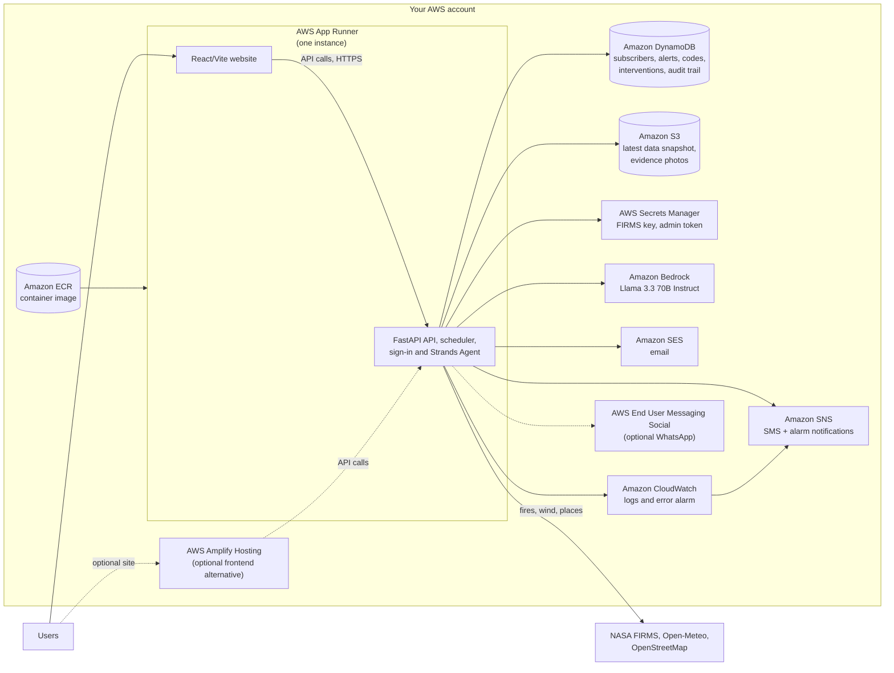
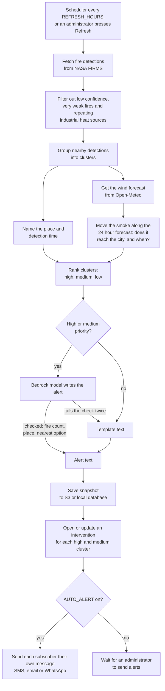
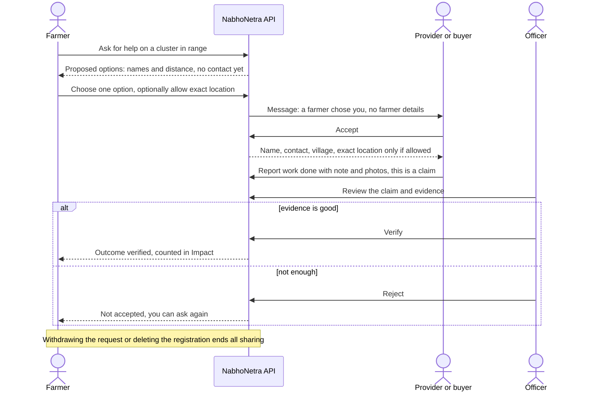
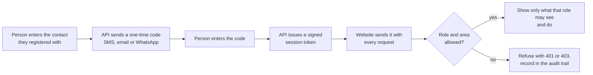

# NabhoNetra: crop-fire intelligence

NabhoNetra uses NASA satellite data to identify crop-residue fires and estimate smoke risk to nearby cities. It connects farmers seeking help with providers, while officers verify outcomes and administrators oversee the response.

Built for farmers, machine providers, biomass buyers, field officers and administrators, NabhoNetra combines a React/Vite website, a Python/FastAPI backend and Strands Agents. Its main cloud deployment runs on AWS.

## Contents
1. [Architecture](#1-architecture)
2. [AWS services used](#2-aws-services-used)
3. [How it works (flowcharts)](#3-how-it-works)
4. [Roles, privacy and security](#4-roles-privacy-and-security)
5. [Build it locally](#5-build-it-locally)
6. [Ship it on AWS](#6-ship-it-on-aws)
7. [Configuration reference](#7-configuration-reference)
8. [Tests](#8-tests)
9. [Operating it, troubleshooting](#9-operating-it-and-troubleshooting)
10. [Project layout](#10-project-layout)
11. [Notes and limits](#11-notes-and-limits)
12. [Future implementation](#12-future-implementation)

---

## 1. Architecture

PNG copies of the diagrams are in `docs/diagrams/`.

By default, App Runner serves the React/Vite frontend and FastAPI backend. AWS mode uses DynamoDB and S3 for data, Secrets Manager for credentials, and SNS/SES for notifications. Strands Agents powers AI alerts with Amazon Bedrock. Local mode defaults to SQLite and reads settings from `backend/.env`.



App Runner runs one instance because the refresh scheduler runs inside the app. Amplify is an optional separate frontend; in either path, browser access is restricted by `CORS_ORIGINS` and the admin token stays on the server.

## 2. AWS services used

### Main production services

The production path uses these AWS services. The deploy script creates the ECR repository; CloudFormation provisions the app stack.

| Service | Purpose |
|---|---|---|
| **AWS App Runner** | Runs the FastAPI container, website and in-process scheduler |
| **Amazon ECR** | Stores the container image deployed to App Runner |
| **Amazon DynamoDB** | Stores subscribers, codes, alerts, interventions and audit records |
| **Amazon S3** | Stores snapshots, evidence photos and cached listings |
| **AWS Secrets Manager** | Supplies the FIRMS key and admin token |
| **Amazon Bedrock** | Runs the AI model used by Strands Agents for alert text |
| **Amazon SNS** | Sends SMS alerts and CloudWatch alarm notifications |
| **Amazon SES** | Sends email alerts and sign-in codes in live mode |
| **Amazon CloudWatch** | Collects App Runner logs and monitors 5xx errors |
| **AWS IAM** | Grants the App Runner services access to AWS resources |
| **AWS CloudFormation** | Provisions the stack from `deploy/apprunner.yaml` |

**Bedrock model:** `us.meta.llama3-3-70b-instruct-v1:0` (Llama 3.3 70B Instruct, default region `us-west-2`). If model access is unavailable, alerts fall back to templates.

### Optional deployment paths and integrations

These are not required for the default App Runner deployment:

- **AWS Amplify Hosting** — host the frontend separately from the API.
- **AWS End User Messaging Social** — enable WhatsApp by configuring a phone number ID.
- **SMTP** — alternate email provider when SES is not used.
- **Custom domain** — use your own public website address.

### External services used by the app

External runtime services (not AWS):
- **NASA FIRMS**: fire detections
- **Open-Meteo**: wind and forecast data
- **OpenStreetMap Overpass / Nominatim**: place names and alternative-provider listings
- **Esri / CARTO map tiles**: map rendering

## 3. How it works

### 3.1 Data pipeline (every few hours)



### 3.2 A farmer's request, from ask to verified outcome



### 3.3 Sign-in and access check



### 3.4 What shipping to AWS does


## 4. Roles, privacy and security

| Role | Sees | Can do |
|---|---|---|
| Public visitor | Alerts, map, wind, recommendations, resources and timeline | Join or sign in |
| Farmer | Nearby interventions, own requests and proposed options | Request help, choose or decline an option, optionally share exact location, withdraw |
| Provider / biomass buyer | Requests matched to them | Accept or decline, upload evidence, report work (a claim) |
| Officer | Interventions in their assigned area | Send requests, find options, verify or reject claims |
| Administrator | All records and audit trail | Refresh data, send alerts, register officers |

**Farmer privacy.** Providers initially see only the need, crop, acres and rough distance. Name, contact and village are shared only after a provider accepts.

**Completion is not verification.** Officers review each provider's work claim and evidence; only verified claims count toward impact.

**Administrator access.** Create administrators on the server with `python make_admin.py` (never through the website/API). They sign in with a one-time code; the website never receives the admin token.

**Other controls**

| Control | Detail |
|---|---|
| Audit trail | Records sign-ins, refreshes, alerts, officer registration, requests, claim decisions, evidence views and denied attempts—never contact details. |
| Staff codes | Officer/admin one-time codes are never shown on the page, even in test mode. |
| Sessions | Signed tokens expire after 30 days (users), 3 days (officers) or 8 hours (administrators). |
| CORS | Only `CORS_ORIGINS` (HTTPS or localhost) and the `x-session` / `Content-Type` headers are allowed; never `*`. |
| Browser policy | Amplify sets CSP, HSTS, no framing and no content sniffing. |
| Rate limits | Per-IP limits on sign-up, codes, requests and uploads; daily verification-message cap. |
| Data | Evidence photos: JPEG/PNG under 5 MB. DynamoDB point-in-time recovery is on; tables are retained if the stack is deleted. |

## 5. Build it locally

**You need:** Python 3.12, Node.js 20 and Git. Sample-data mode needs no AWS account.

```powershell
# 1. Backend
cd backend
python -m venv .venv; .\.venv\Scripts\Activate.ps1
pip install -r requirements.txt
copy .env.example .env          # set FIRMS_KEY and ADMIN_TOKEN for live data/admin tools

# 2. Website
cd ..\frontend
npm install
npm run build                   # the server serves frontend\dist

# 3. Run
cd ..\backend
python server.py                # open http://127.0.0.1:8000
```

- **Sample data, no network or keys:** `$env:PIPELINE_MOCK="1"; python server.py`.
- **First run:** place lookups are cached; `/api/data` may return 503 for a minute or two.
- **Live reload:** run the backend, then `cd frontend; npm run dev` in another window and open http://localhost:5173 (API requests are proxied).
- **Separate frontend configuration:** copy `frontend/.env.example` to `frontend/.env` only when configuring a separate frontend; `VITE_API_URL` is public build-time configuration, never a secret.
- **Test the Amplify-style split locally:** build with `$env:VITE_API_URL="http://127.0.0.1:8000"; npm run build`, serve `frontend\dist` on another port, and start the server with `$env:CORS_ORIGINS="http://localhost:5173"; python server.py`.
- **Create an administrator, then sign in:** `python make_admin.py --name "Your name" --channel email --contact you@example.com`. In `DELIVERY=log` mode, farmer/provider codes appear in server logs.
- **All India:** set `SCOPE=india` in `backend/.env` and restart; the app keeps the largest `MAX_CLUSTERS` (default 25) and assesses each against its nearest major city.
- **Docker:** `docker build -t nabhonetra .` then `docker run -p 8000:8000 --env-file backend/.env -v nabhonetra-data:/data nabhonetra`.

## 6. Ship it on AWS

### 6.1 Main deployment path

For production, you need:

1. An AWS account with access to CloudFormation, ECR, IAM, App Runner, DynamoDB, S3, Secrets Manager, SNS, SES, CloudWatch and Bedrock.
2. **US West (Oregon), `us-west-2`** is the default region and supports the configured Bedrock model.
3. Enable access to `us.meta.llama3-3-70b-instruct-v1:0`; alerts use templates if the model is unavailable.
4. Get a NASA FIRMS map key and create an admin token (`openssl rand -hex 24`). Store the token securely.
5. For live email, verify an SES sender identity; in the SES sandbox, verify each recipient too.

### 6.2 Deploy with AWS CloudShell (no Docker on your PC)
CloudShell is the `>_` icon in the AWS console. It includes Docker and the AWS CLI. Upload and unzip the repository source, then run the following from its `deploy/` directory:

```bash
read -rsp "FIRMS key: " FIRMS_KEY; echo; export FIRMS_KEY
export ADMIN_TOKEN=$(openssl rand -hex 24); echo "SAVE THIS ADMIN TOKEN: $ADMIN_TOKEN"

# Safe first deployment: messages are logged, not sent.
DELIVERY_MODE=log bash deploy.sh
```

The default deploy uses App Runner to serve both the API and website. It can take 15 minutes or more and prints:

```
Website: https://xxxx.us-west-2.awsapprunner.com
API:     https://xxxx.us-west-2.awsapprunner.com
```

Keep the CloudShell tab open while it runs. If the build says "no space left on device", run `docker system prune -af` and retry.

Optional environment variables: `OPS_EMAIL` (alarm emails), `SES_FROM` (verified sender), `PUBLIC_URL` (custom domain), `REGION`, `STACK`, `CORS_ORIGINS`, `DELIVERY_MODE` and `FRONTEND`.

### 6.3 Deploy from your PC (PowerShell, needs Docker Desktop)
```powershell
cd deploy
.\deploy.ps1 -FirmsKey KEY -AdminToken LONG_TOKEN -DeliveryMode log
```
This serves the website from App Runner (single link). For the Amplify frontend, use `deploy.sh` in CloudShell or WSL/Linux/macOS.

### 6.4 Optional deployment choices

- **Separate frontend on Amplify:** run `FRONTEND=amplify DELIVERY_MODE=log bash deploy.sh` from `deploy/`.
- **WhatsApp:** set the `WhatsappPhoneId` CloudFormation parameter and use an approved AWS End User Messaging Social number.
- **Custom domain:** set `PUBLIC_URL` and configure the domain.
- **SMTP:** an alternate email provider for local or customized deployments; the default CloudFormation stack uses SES.

### 6.5 Create the first administrator
App Runner has no shell, so run this in CloudShell (or on your PC with `$env:STORE="dynamodb"; $env:DDB_PREFIX="nabhonetra"; $env:STORE_REGION="us-west-2"` set first and removed afterwards):

```bash
cd ../backend
STORE=dynamodb DDB_PREFIX=nabhonetra STORE_REGION=us-west-2 python3 make_admin.py --name "Your name" --channel email --contact you@example.com
```
Open the website and sign in with that email. In `log` mode, find the code in CloudWatch Logs (`/aws/apprunner/nabhonetra/.../application`, search `code:`); live mode sends it by email or SMS.

### 6.6 Check it works
- Confirm `https://YOUR-API/api/health` is healthy; `/api/data` may return 503 during its first run.
- Test the workflow: farmer requests help and chooses a provider; the provider accepts and reports work; an administrator verifies the claim.
- Test alert delivery in `log` mode first; never turn on `live` mode on a production stack until the test flow is proven.

### 6.7 Go fully live
Re-run the same command without `DELIVERY_MODE=log`, with `SES_FROM` and `OPS_EMAIL` set. Live mode really sends messages and turns on automatic alerts.
- **Email:** SES production access (leave the sandbox) so you can write to any address.
- **SMS:** new SNS accounts start in the SMS sandbox. India needs sender ID and DLT registration.
- **WhatsApp (optional):** use an approved WhatsApp Business account and set the `WhatsappPhoneId` CloudFormation parameter.
- Never turn on demo data (`IncludeDemo`) on the stack real users use.

### 6.8 Update, redeploy, remove
| Task | Command |
|---|---|
| New code | Upload the new zip to CloudShell and run the same `deploy.sh` command again |
| Website only | `API_URL=https://your-api bash deploy/deploy-frontend.sh` |
| Build on every Git push (optional) | In the Amplify console connect your GitHub repo, set the environment variable `VITE_API_URL` and the monorepo folder `frontend` (see `amplify.yml`) |
| Remove the API | `aws cloudformation delete-stack --stack-name nabhonetra --region us-west-2` (DynamoDB tables are kept on purpose) |
| Remove the website | `aws amplify delete-app --app-id APP_ID --region us-west-2` |

App Runner bills while it runs. Check current AWS pricing for App Runner, Amplify, DynamoDB, Bedrock, SNS and SES before going live.

## 7. Configuration reference
Local backend settings go in `backend/.env` (see `backend/.env.example`). For a separate frontend, use `frontend/.env.example`. On AWS, `deploy/apprunner.yaml` supplies deployment settings.

| Setting | Meaning |
|---|---|
| `FIRMS_KEY` | NASA FIRMS map key (required) |
| `ADMIN_TOKEN` | For scripts and operators, and the default signing secret. 16+ characters. The website never asks for it |
| `DELIVERY` | `log` = nothing sent, codes shown on screen (test). `live` = really send |
| `AUTO_ALERT`, `REFRESH_HOURS`, `ALERT_WINDOW_UTC` | Automatic alerts and how often data refreshes |
| `SCOPE`, `BBOX`, `CITY_LAT`, `CITY_LON`, `MAX_CLUSTERS` | What area to watch and which city to protect |
| `MODEL_PROVIDER`, `MODEL_ID`, `AWS_REGION` | AI model: `bedrock` (default), `openai` (Gemini via compatible API) or `ollama` (local) |
| `USE_AGENT` | `0` = templates only, no AI cost |
| `STORE`, `DDB_PREFIX`, `STORE_REGION`, `SNAPSHOT_BUCKET` | `sqlite` locally, `dynamodb` + S3 on AWS |
| `PUBLIC_URL` | Address of the website, used in response links |
| `CORS_ORIGINS` | Website address(es) allowed to call the API when hosted elsewhere, comma separated |
| `TOKEN_SECRET`, `TRUST_PROXY`, `OTP_DAILY_MAX` | Signing secret, proxy trust (on in App Runner), daily code cap |
| `EMAIL_PROVIDER`, `SES_FROM`, `SMTP_*` | Email through SES or SMTP |
| `WHATSAPP_PHONE_ID`, `WHATSAPP_TEMPLATE` | Optional WhatsApp |
| `VITE_API_URL` (website build) | API address when the website is hosted separately |

## 8. Tests
```powershell
cd backend
pip install -r requirements-dev.txt
python smoke_test.py       # sign-up, codes, requests, consent, claims, officers, admin, audit, CORS
python eval_agent.py       # filters, forecast, alert checker, impact comparison (offline)
python dynamo_test.py      # DynamoDB and S3 against a simulated AWS
python env_test.py         # .env reader and .env.example
cd ..\frontend; npm test
```
`python eval_agent.py --live` also tries your real model. The deploy template passes `cfn-lint`, but has not been run in your account by the author, so use a test account first.

## 9. Operating it and troubleshooting

| Symptom | Cause and fix |
|---|---|
| `/` shows 404 locally | Website not built. `cd frontend; npm install; npm run build` |
| `/api/data` returns 503 | First data run still going (can take minutes: OpenStreetMap servers are often busy). Retry |
| Website loads but shows no data on Amplify | `VITE_API_URL` wrong or the API does not list the website in `CORS_ORIGINS`. Re-run `deploy.sh` with `FRONTEND=amplify` |
| Alerts are plain templates | Bedrock model access not enabled in the region, or `USE_AGENT=0` |
| Sign-in code never arrives | `DELIVERY=log` (read it from the logs for staff), SES sandbox (verify the address), SNS sandbox or DLT |
| Deploy fails | CloudFormation console, stack `nabhonetra`, Events tab: the first red line says why |
| Where are logs | CloudWatch Logs `/aws/apprunner/nabhonetra/.../application` |

## 10. Project layout
```
backend/   server.py (API, scheduler)  engine.py (interventions, requests, consent, claims)  pipeline.py (fires, clusters, wind)
           agent.py (AI alerts)  store.py (SQLite or DynamoDB + S3)  places.py  impact.py  make_admin.py  seed_demo.py  *_test.py
frontend/  src/ React website (Interventions, RolePanel, Account, MapPage, Subscribe, Respond)
deploy/    apprunner.yaml (CloudFormation)  deploy.sh  deploy-frontend.sh  deploy.ps1
amplify.yml  Dockerfile  .dockerignore
```

## 11. Notes and limits
- The risk index is an estimate from wind, distance and fire count, not a measured share of city air quality. Observed fires and estimated risk are shown separately.
- Detection times are UTC from the satellite; the website shows local time. Place names come from OpenStreetMap and are cached.
- FIRMS reports all thermal anomalies, so outside the paddy season many detections are forest or industrial fires.
- Machinery and biomass listings come from OpenStreetMap and are not verified.
- The Impact page shows an association between alerts and later fire counts, not proof.
- One App Runner instance on purpose: the scheduler and rate limiter live inside the app.
- Requests attach to a cluster near the farmer. Asking for help before any fire is detected is not covered yet.
- Demo mode (`INCLUDE_DEMO=1`, `python seed_demo.py`, test mode only) marks demo records clearly and never messages them.

## 12. Future implementation
Ideas, **not built yet**, roughly in order of value:

| Area | Idea |
|---|---|
| Prevention | Let farmers request help before a fire appears (planned harvest, machine booking ahead of the season) |
| Languages | Translate the website into Hindi, Punjabi and other languages (alerts already follow `ALERT_LANG`) |
| Mobile | Installable app (PWA), offline requests, push notifications |
| Verification | Satellite burn-scar or crop-residue checks (for example Sentinel-2) to support officer decisions |
| Identity | Amazon Cognito for managed sign-in and multi-factor authentication for officers and administrators |
| Scale | Move the scheduler to EventBridge so several API instances can run; DynamoDB indexes instead of scans; AWS WAF in front of the API |
| Delivery | Production WhatsApp, delivery receipts, retry queue (SQS) |
| Government data | Link to machinery subsidy and custom-hiring-centre registries, district dashboards and exports for officers |
| Impact | A stronger evaluation method, and incentive or payment tracking tied to verified outcomes |
| Operations | CI/CD with GitHub Actions (tests, `cfn-lint`, deploy), infrastructure for Amplify in CloudFormation, dashboards and cost alarms |
| Compliance | Data-retention schedule and consent records aligned with India's DPDP Act |
