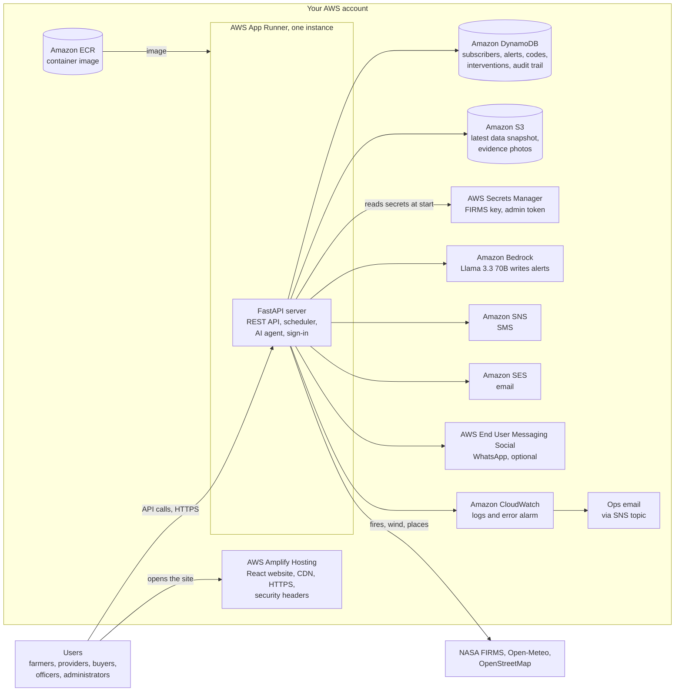
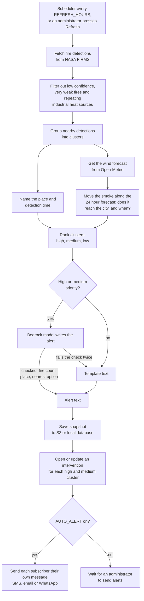
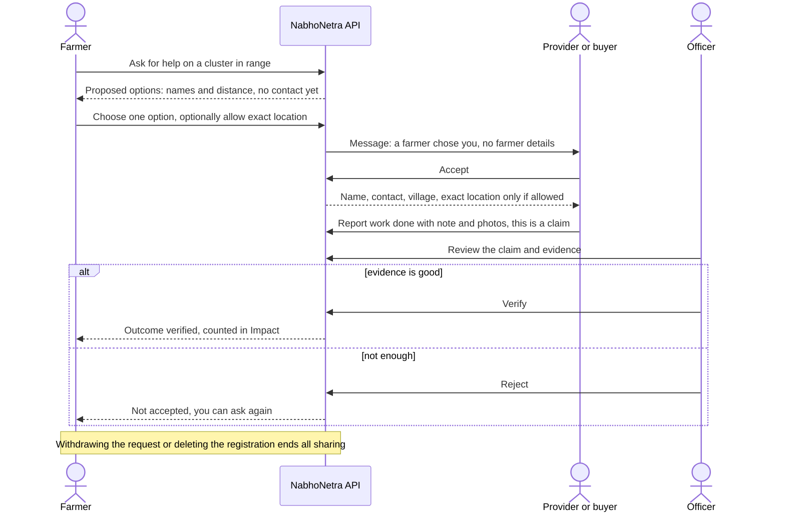
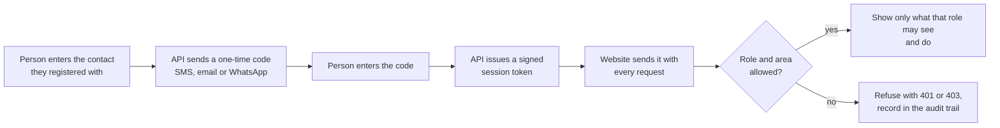
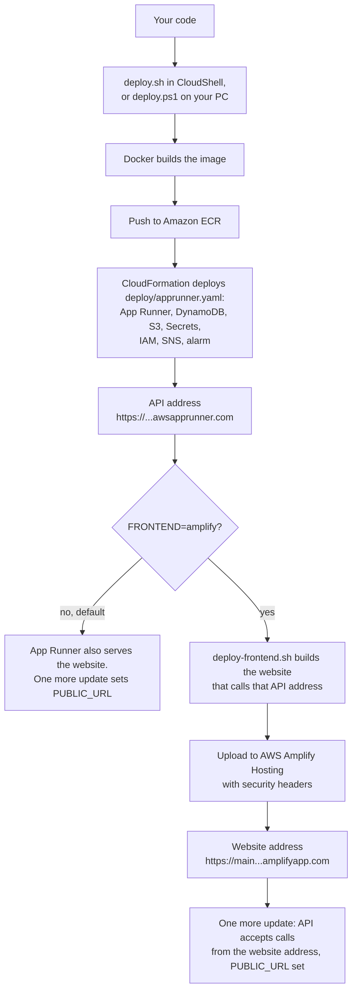

# NabhoNetra: crop-fire intelligence

NabhoNetra finds crop-residue fires from NASA satellite data, works out whether the smoke will reach a city, and turns each high-risk fire cluster into a **coordinated intervention**: farmers ask for help, registered machine providers and biomass buyers are proposed, an officer verifies the outcome, and only verified outcomes count as results.

Built for farmers, machine providers, biomass buyers, field officers and administrators. React website, Python (FastAPI) server, and a Strands Agents AI layer using Amazon Bedrock by default, hosted on AWS.

## Contents
1. [Architecture](#1-architecture)
2. [AWS services used](#2-aws-services-used)
3. [How it works (flowcharts)](#3-how-it-works)
4. [Roles, privacy and security](#4-roles-privacy-and-security)
5. [Build it locally](#5-build-it-locally)
6. [Ship it on AWS](#6-ship-it-on-aws)
7. [Configuration reference](#7-configuration-reference)
8. [Tests](#8-tests)
9. [Operating it, troubleshooting](#9-operating-it-and-troubleshooting)
10. [Project layout](#10-project-layout)
11. [Notes and limits](#11-notes-and-limits)
12. [Future implementation](#12-future-implementation)

---

## 1. Architecture

PNG copies of every diagram in this README are in `docs/diagrams/` for slides.

The website is static files on **AWS Amplify Hosting**. The server (API, scheduler and AI agent) runs on **AWS App Runner**. Data lives in **DynamoDB** and **S3**. Alerts and sign-in codes go out through **SNS** (SMS), **SES** (email) and optionally WhatsApp. Amplify cannot run a Python server, which is why the API stays on App Runner. You can also let App Runner serve the website too and skip Amplify (default mode).



**Why this split.** The browser loads the website from Amplify and then talks to the API directly. The API only accepts browser calls from your website's address (CORS), and the admin token can never be sent from a web page.

## 2. AWS services used

| Service | What it does here | Defined in |
|---|---|---|
| **AWS Amplify Hosting** | Serves the React website over HTTPS from a CDN, adds browser security headers | `deploy/deploy-frontend.sh` (optional `amplify.yml` for Git builds) |
| **AWS App Runner** | Runs the container: REST API, 3-hourly data refresh, AI agent. One instance on purpose, because the scheduler runs inside the app | `deploy/apprunner.yaml` |
| **Amazon ECR** | Stores the container image App Runner starts | created by `deploy/deploy.sh` |
| **Amazon DynamoDB** (5 tables) | Subscribers, alerts, one-time codes (expire automatically), interventions with requests and claims, audit trail (the app can add rows but never change or delete them) | `deploy/apprunner.yaml` |
| **Amazon S3** | Latest data snapshot and evidence photos | `deploy/apprunner.yaml` |
| **AWS Secrets Manager** | FIRMS key and admin token, handed to the container at start | `deploy/apprunner.yaml` |
| **Amazon Bedrock** | Writes the alert text (default model Llama 3.3 70B). Templates are used if the model fails or for low-priority clusters | needs model access enabled |
| **Amazon SNS** | SMS to subscribers, and the ops-alert topic | `deploy/apprunner.yaml` |
| **Amazon SES** | Email alerts and sign-in codes | verify identities yourself |
| **AWS End User Messaging Social** | WhatsApp (optional, untested here) | `WhatsappPhoneId` parameter |
| **Amazon CloudWatch** | Application logs, alarm on server errors that emails you | `deploy/apprunner.yaml` |
| **AWS IAM** | One role for pulling the image, one for the running app (least privilege) | `deploy/apprunner.yaml` |
| **AWS CloudFormation** | Creates and updates everything above in one stack called `nabhonetra` | `deploy/apprunner.yaml` |

Outside AWS: NASA FIRMS (fire detections), Open-Meteo (wind, forecast, air quality), OpenStreetMap Overpass and Nominatim (machinery listings, place names), Esri and CARTO (map tiles).

## 3. How it works

### 3.1 Data pipeline (every few hours)



### 3.2 A farmer's request, from ask to verified outcome



### 3.3 Sign-in and access check



### 3.4 What shipping to AWS does



## 4. Roles, privacy and security

| Role | Sees | Can do |
|---|---|---|
| Public visitor | Alerts, map, wind, AI recommendation, suggested resources, timeline | Join or sign in |
| Farmer | Interventions in their alert radius, their own requests and options proposed for them | Ask for help, choose or turn down an option, allow exact location (optional), withdraw |
| Machine provider / biomass buyer | Only requests matched to them | Accept or decline, upload photo evidence, report work done (a claim) |
| Officer | Interventions in their assigned district or state, or their own radius, never everything | Send requests, look for more options, verify or reject each claim |
| Administrator | Everything, plus the audit trail | Refresh data, send alerts, register officers |

**Farmer privacy.** Nothing about a farmer is shared when they ask. A provider first sees only the need, crop, acres and a rough distance. Name, contact and village appear after the provider accepts the job the farmer chose, and exact coordinates only if the farmer allowed it. Withdrawing the request or deleting the registration ends the sharing at once. Public counts hide acreage and needs when fewer than 3 farmers are in range.

**Completion is not verification.** A provider reports work done: that is a claim. An officer in the area reviews the note and photos and verifies or rejects each claim. Only verified claims count on the Impact page.

**Administrator access.** Administrators are created only on the server (`python make_admin.py`), never through the website or API, and sign in with a one-time code (8 hour sessions). The website never asks for or stores the admin token. `ADMIN_TOKEN` exists for scripts and operators calling the API directly and as the default signing secret.

**Other controls**

| Control | Detail |
|---|---|
| Audit trail | Sign-ins, refreshes, alerts, officer registration, requests, claim decisions, evidence views and denied attempts: who, what, when, from where, never contact details. Administrators read it at the bottom of Interventions or at `/api/audit` |
| Codes for staff | One-time codes for officers and administrators are never shown on the page, even in test mode |
| Sessions | Signed tokens: 30 days (farmer, provider, buyer), 3 days (officer), 8 hours (administrator) |
| CORS | The API accepts browser calls only from `CORS_ORIGINS` (https, or localhost), allows only the `x-session` and `Content-Type` headers, never `*` |
| Browser policy | On Amplify: Content-Security-Policy (own scripts only, API address only), HSTS, no framing, no sniffing |
| Rate limits | Per IP on sign-up, codes, requests and uploads; daily cap on verification messages |
| Data | Evidence photos limited to JPEG or PNG under 5 MB; DynamoDB point-in-time recovery on; tables kept if the stack is deleted |

## 5. Build it locally

**You need:** Python 3.12, Node.js 20, Git. No AWS account is needed for sample-data mode.

```powershell
# 1. Backend
cd backend
python -m venv .venv; .\.venv\Scripts\Activate.ps1
pip install -r requirements.txt
copy .env.example .env          # then edit FIRMS_KEY and ADMIN_TOKEN

# 2. Website
cd ..\frontend
npm install
npm run build                   # the server serves frontend\dist

# 3. Run
cd ..\backend
python server.py                # open http://127.0.0.1:8000
```

- **Quick look with no network and no keys:** `$env:PIPELINE_MOCK="1"; python server.py` uses sample fire data.
- **First run is slow:** place names and OpenStreetMap listings are looked up and cached. `/api/data` returns 503 for a minute or two until the first run finishes.
- **Develop the website with live reload:** run the server as above, then in another window `cd frontend; npm run dev` and open http://localhost:5173 (it forwards `/api` to the server).
- **Test the Amplify-style split locally:** build with `$env:VITE_API_URL="http://127.0.0.1:8000"; npm run build`, serve `frontend\dist` on another port, and start the server with `$env:CORS_ORIGINS="http://127.0.0.1:8080"`.
- **Create your administrator, then sign in on the site:** `python make_admin.py --name "Your name" --channel email --contact you@example.com`. In test mode (`DELIVERY=log`) farmer and provider codes show on screen. Officer and administrator codes are printed in the server window.
- **All India:** set `SCOPE=india` in `.env` and restart. The app then pulls every VIIRS detection in India, keeps the `MAX_CLUSTERS` biggest clusters (default 25) and judges each against its nearest major city. Outside October and November many detections are not crop fires.
- **Docker alone:** `docker build -t nabhonetra .` then `docker run -p 8000:8000 --env-file backend/.env -v nabhonetra-data:/data nabhonetra`.

## 6. Ship it on AWS

### 6.1 One-time setup
1. **AWS account** with permission to use CloudFormation, ECR, IAM, App Runner, DynamoDB, S3, Secrets Manager, SNS, CloudWatch and Amplify. An administrator account is simplest.
2. **Region:** use **US West (Oregon) us-west-2**, where the default model is available.
3. **Bedrock model access:** AWS console, Bedrock, Model access, enable the model named in `ModelId` (default Llama 3.3 70B). Without it, alerts fall back to templates.
4. **Keys:** your NASA FIRMS map key, and a fresh admin token (`openssl rand -hex 24`). Save the token in a password manager.
5. **Email for sign-in codes (live mode only):** SES, Verified identities, create and verify your sender address. While SES is in sandbox, verify each recipient too.

### 6.2 Deploy with AWS CloudShell (no Docker on your PC)
CloudShell is the `>_` icon in the AWS console top bar, and it already has Docker and the AWS CLI. Upload the project zip (Actions, Upload file), then:

```bash
unzip -q cropfire-agent-updated.zip; cd cropfire-agent/deploy
read -rsp "FIRMS key: " FIRMS_KEY; echo; export FIRMS_KEY
export ADMIN_TOKEN=$(openssl rand -hex 24); echo "SAVE THIS ADMIN TOKEN: $ADMIN_TOKEN"

# Website on Amplify, API on App Runner. First try-out: nothing is really sent.
FRONTEND=amplify DELIVERY_MODE=log bash deploy.sh
```

It can take 15 minutes or more and prints:

```
Website: https://main.xxxx.amplifyapp.com     <- your live link
API:     https://xxxx.us-west-2.awsapprunner.com
```

Leave out `FRONTEND=amplify` to let App Runner serve the website itself (one link, one fewer service). Keep the CloudShell tab open while it runs. If the build says "no space left on device", run `docker system prune -af` and start again.

Optional settings (environment variables): `OPS_EMAIL` (error alarm emails, click the confirmation link AWS sends), `SES_FROM` (verified sender), `PUBLIC_URL` (your own domain), `REGION`, `STACK`.

### 6.3 Deploy from your PC (PowerShell, needs Docker Desktop)
```powershell
cd deploy
.\deploy.ps1 -FirmsKey KEY -AdminToken LONG_TOKEN -DeliveryMode log
```
This serves the website from App Runner (one link). For the Amplify website use `deploy.sh` in CloudShell, or in WSL, macOS or Linux.

### 6.4 Create the first administrator
App Runner has no shell, so run this in CloudShell (or on your PC with `$env:STORE="dynamodb"; $env:DDB_PREFIX="nabhonetra"; $env:STORE_REGION="us-west-2"` set first and removed afterwards):

```bash
cd ../backend
STORE=dynamodb DDB_PREFIX=nabhonetra STORE_REGION=us-west-2 python3 make_admin.py --name "Your name" --channel email --contact you@example.com
```
Open the website, press **Sign in**, enter that email. In `log` mode the code is in CloudWatch Logs (Log groups, `/aws/apprunner/nabhonetra/.../application`, search `code:`). In live mode it arrives by email.

### 6.5 Check it works
- `https://YOUR-API/api/health` shows ok. A 503 on `/api/data` for the first minute or two is normal.
- Open the website, join as a test farmer and a test provider, sign in as the farmer, ask for help, choose the provider, sign in as the provider to accept and report work, then sign in as the administrator to verify and read the audit trail.

### 6.6 Go fully live
Re-run the same command without `DELIVERY_MODE=log`, with `SES_FROM` and `OPS_EMAIL` set. Live mode really sends messages and turns on automatic alerts.
- **Email:** SES production access (leave the sandbox) so you can write to any address.
- **SMS:** new SNS accounts start in the SMS sandbox. India needs sender ID and DLT registration.
- **WhatsApp (optional):** an approved WhatsApp Business account in AWS End User Messaging Social. Pass `WhatsappPhoneId`. Untested here.
- Never turn on demo data (`IncludeDemo`) on the stack real users use.

### 6.7 Update, redeploy, remove
| Task | Command |
|---|---|
| New code | Upload the new zip to CloudShell and run the same `deploy.sh` command again |
| Website only | `API_URL=https://your-api bash deploy/deploy-frontend.sh` |
| Build on every Git push (optional) | In the Amplify console connect your GitHub repo, set the environment variable `VITE_API_URL` and the monorepo folder `frontend` (see `amplify.yml`). Then re-run `deploy.sh` with `CORS_ORIGINS=https://your-git-site-address PUBLIC_URL=https://your-git-site-address` so the API accepts that site |
| Remove the API | `aws cloudformation delete-stack --stack-name nabhonetra --region us-west-2` (DynamoDB tables are kept on purpose) |
| Remove the website | `aws amplify delete-app --app-id APP_ID --region us-west-2` |

App Runner bills while it runs. Check current AWS pricing for App Runner, Amplify, DynamoDB, Bedrock, SNS and SES before going live.

## 7. Configuration reference
Local: `backend/.env`. On AWS: `deploy/apprunner.yaml` parameters set these for you. Full commented list in `backend/.env.example`.

| Setting | Meaning |
|---|---|
| `FIRMS_KEY` | NASA FIRMS map key (required) |
| `ADMIN_TOKEN` | For scripts and operators, and the default signing secret. 16+ characters. The website never asks for it |
| `DELIVERY` | `log` = nothing sent, codes shown on screen (test). `live` = really send |
| `AUTO_ALERT`, `REFRESH_HOURS`, `ALERT_WINDOW_UTC` | Automatic alerts and how often data refreshes |
| `SCOPE`, `BBOX`, `CITY_LAT`, `CITY_LON`, `MAX_CLUSTERS` | What area to watch and which city to protect |
| `MODEL_PROVIDER`, `MODEL_ID`, `AWS_REGION` | AI model: `bedrock` (default), `openai` (Gemini via compatible API) or `ollama` (local) |
| `USE_AGENT` | `0` = templates only, no AI cost |
| `STORE`, `DDB_PREFIX`, `STORE_REGION`, `SNAPSHOT_BUCKET` | `sqlite` locally, `dynamodb` + S3 on AWS |
| `PUBLIC_URL` | Address of the website, used in response links |
| `CORS_ORIGINS` | Website address(es) allowed to call the API when hosted elsewhere, comma separated |
| `TOKEN_SECRET`, `TRUST_PROXY`, `OTP_DAILY_MAX` | Signing secret, proxy trust (on in App Runner), daily code cap |
| `EMAIL_PROVIDER`, `SES_FROM`, `SMTP_*` | Email through SES or SMTP |
| `WHATSAPP_PHONE_ID`, `WHATSAPP_TEMPLATE` | Optional WhatsApp |
| `VITE_API_URL` (website build) | API address when the website is hosted separately |

## 8. Tests
```powershell
cd backend
pip install -r requirements-dev.txt
python smoke_test.py       # sign-up, codes, requests, consent, claims, officers, admin, audit, CORS
python eval_agent.py       # filters, forecast, alert checker, impact comparison (offline)
python dynamo_test.py      # DynamoDB and S3 against a simulated AWS
python env_test.py         # .env reader and .env.example
cd ..\frontend; npm test
```
`python eval_agent.py --live` also tries your real model. The deploy template passes `cfn-lint`, but has not been run in your account by the author, so use a test account first.

## 9. Operating it and troubleshooting

| Symptom | Cause and fix |
|---|---|
| `/` shows 404 locally | Website not built. `cd frontend; npm install; npm run build` |
| `/api/data` returns 503 | First data run still going (can take minutes: OpenStreetMap servers are often busy). Retry |
| Website loads but shows no data on Amplify | `VITE_API_URL` wrong or the API does not list the website in `CORS_ORIGINS`. Re-run `deploy.sh` with `FRONTEND=amplify` |
| Alerts are plain templates | Bedrock model access not enabled in the region, or `USE_AGENT=0` |
| Sign-in code never arrives | `DELIVERY=log` (read it from the logs for staff), SES sandbox (verify the address), SNS sandbox or DLT |
| Deploy fails | CloudFormation console, stack `nabhonetra`, Events tab: the first red line says why |
| Where are logs | CloudWatch Logs `/aws/apprunner/nabhonetra/.../application` |

## 10. Project layout
```
backend/   server.py (API, scheduler)  engine.py (interventions, requests, consent, claims)  pipeline.py (fires, clusters, wind)
           agent.py (AI alerts)  store.py (SQLite or DynamoDB + S3)  places.py  impact.py  make_admin.py  seed_demo.py  *_test.py
frontend/  src/ React website (Interventions, RolePanel, Account, MapPage, Subscribe, Respond)
deploy/    apprunner.yaml (CloudFormation)  deploy.sh  deploy-frontend.sh  deploy.ps1
amplify.yml  Dockerfile  .dockerignore
```

## 11. Notes and limits
- The risk index is an estimate from wind, distance and fire count, not a measured share of city air quality. Observed fires and estimated risk are shown separately.
- Detection times are UTC from the satellite; the website shows local time. Place names come from OpenStreetMap and are cached.
- FIRMS reports all thermal anomalies, so outside the paddy season many detections are forest or industrial fires.
- Machinery and biomass listings come from OpenStreetMap and are not verified.
- The Impact page shows an association between alerts and later fire counts, not proof.
- One App Runner instance on purpose: the scheduler and rate limiter live inside the app.
- Requests attach to a cluster near the farmer. Asking for help before any fire is detected is not covered yet.
- Demo mode (`INCLUDE_DEMO=1`, `python seed_demo.py`, test mode only) marks demo records clearly and never messages them.

## 12. Future implementation
Ideas, **not built yet**, roughly in order of value:

| Area | Idea |
|---|---|
| Prevention | Let farmers request help before a fire appears (planned harvest, machine booking ahead of the season) |
| Languages | Translate the website into Hindi, Punjabi and other languages (alerts already follow `ALERT_LANG`) |
| Mobile | Installable app (PWA), offline requests, push notifications |
| Verification | Satellite burn-scar or crop-residue checks (for example Sentinel-2) to support officer decisions |
| Identity | Amazon Cognito for managed sign-in and multi-factor authentication for officers and administrators |
| Scale | Move the scheduler to EventBridge so several API instances can run; DynamoDB indexes instead of scans; AWS WAF in front of the API |
| Delivery | Production WhatsApp, delivery receipts, retry queue (SQS) |
| Government data | Link to machinery subsidy and custom-hiring-centre registries, district dashboards and exports for officers |
| Impact | A stronger evaluation method, and incentive or payment tracking tied to verified outcomes |
| Operations | CI/CD with GitHub Actions (tests, `cfn-lint`, deploy), infrastructure for Amplify in CloudFormation, dashboards and cost alarms |
| Compliance | Data-retention schedule and consent records aligned with India's DPDP Act |
